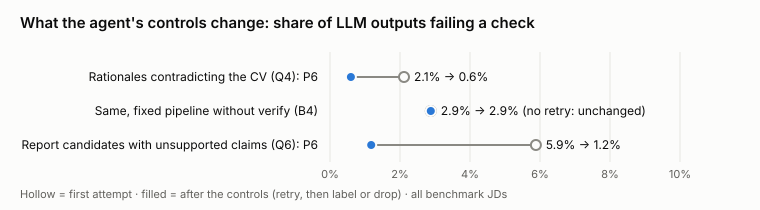
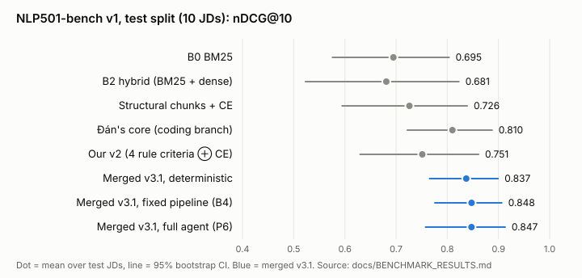

# Agentic CV–JD Ranking for Automation Test Roles: Final Report

NLP501 · Group 2 · Sơn (problem and criteria) · Vũ (literature) · Đán (agentic HR, gaps, and the `coding` branch) ·
Hoa (datasets and metrics) · Thịnh (architecture and experiments)

The official numbers come from **NLP501-bench v1**, the benchmark the team agreed on and froze
(`docs/BENCHMARK.md`). Every current number is generated by a command in §11 and can be checked in the
`docs/*_RESULTS*.md` file named next to it. Numbers from earlier runs, kept to explain a design change, are marked as
such: v2, qwen3:8b, before a fix, or an uncached run.

## Abstract

We built an agent that ranks Automation Test Engineer CVs against a job description and explains every rank. We
evaluated it against the three questions that matter most for an agentic NLP system:

1. Is it genuinely agentic?
2. Is the data processed well?
3. How is what the LLM produces controlled?

The team froze one benchmark that mixes our 50-CV dataset with Đán's independently built 200-CV dataset: 18 JDs, a
locked test split of 10, and every input pinned by checksum. On that test split:

- **The merged system is the best version of the project:** 0.847 nDCG@10 for the full agent and 0.848 for its
  fixed pipeline. That is ahead of Đán's original core (0.810), our v2 (0.751, p = 0.004 for the deterministic
  merge) and every retrieval baseline (0.68–0.73). Its lead over Đán's core is not yet significant (p = 0.22–0.27).
- **Rules score; the LLM controls and explains.** The agent and its fixed twin rank alike (0.847 vs 0.848, p = 0.47). The agent's
  value is the work rules cannot do: asking HR on a vague JD, reading CVs the parser cannot, catching contradicted
  claims (2.1% → 0.6%) and keeping the arbiter to true near-ties.
- **Where the agent decides, the ranking shows it.** On vague twins of all 18 JDs, a pipeline that cannot ask scores
  0.626 nDCG@10. Asking HR recovers 57% of the loss (+0.129, p < 0.001); the agent as it runs scores 0.704 (§5.5).
- **Evaluation found and fixed real faults:**
  - a recall funnel sized for 50 CVs that failed at 200 (the agent rose from 0.60 to 0.77–0.78 on those JDs);
  - an arbiter acting beyond its mandate;
  - a 100% name leak in masking;
  - nine more defects in data processing, three of them found by reading scanned CVs through OCR.
- **A stronger model needed more control, not less.** When Claude instead of qwen3:8b read the JDs, the LLM-only JD
  parser fell from 0.884 to 0.842 nDCG@10 on our JDs. The rules-first hybrid parser did not move.
- **Every LLM output passes code checks at run time** (Q1–Q7 of 13 written criteria; the rest are offline
  evaluations). **The ranking ignores the protected attributes we twinned** (name, gender, age, marital status): no
  score changed in 6 twin variants × 1,800 (CV, JD) pairs.

## 1. Introduction

HR teams hiring automation testers must judge three things that keyword ATS cannot see:

- **Depth:** does the candidate run scripts (L1), write them (L2), build a framework (L3) or design test architecture
  (L4)?
- **Use vs mention:** was a tool used, or only listed?
- **Hedging:** is a mention hedged ("familiar with", "currently learning")?

Keyword matching rewards stuffing. An LLM judge is opaque, position-biased and can invent evidence. We rank with

`Score(CV, JD) = 1[H(c)] × Σ_k w(c, k) · S(c, k)`

where:

- H is a hard knock-out on must-have tools;
- w are per-company-type weights over 8 criteria;
- S are 0–100 criterion scores.

**Contributions:**

1. A LangGraph agent with 12 nodes and 6 bounded loops:
   - rules set every score;
   - the LLM explains and decides only what rules cannot;
   - humans own the decision.
2. A deterministic, bilingual CV/JD NLP pipeline, measured against another team member's generator truth, real text
   and counterfactual twins.
3. 13 written criteria for AI output (Q1–Q13), each with a check and a target. Q1–Q7 run on every output at run
   time, with an action on failure; Q8–Q13 are offline evaluations.
4. **NLP501-bench v1**, the team's frozen benchmark, with a head-to-head of the three versions of the project.
5. The merge of two independently built systems (ours and Đán's `coding` branch) into one.

| Research question | Answered in |
|---|---|
| RQ1 Does structured extraction beat raw-text matching? | §5.1 |
| RQ2 Do HR-configured must-haves and weights fit the company better? | §5.4 |
| RQ3 How much does hybrid retrieval + reranking add over keyword or dense alone? | §5.1 |
| RQ4 What does agentic orchestration add over a fixed pipeline with the same tools? | §3, §5.2, §6 |
| RQ5 Do results and errors differ by JD type and ambiguity? | §5.1, §8 |

### 1.1 Related work, and what our measurements say about it

Vũ's literature review (31 papers, in the midterm deck) shaped the design. Each strand below states what we took and
what our results add.

- **Dense matching of CVs and jobs.** ConFit v2 (Yu et al., 2025) trains contrastive bi-encoders for resume–job
  matching. On test-automation CVs, dense retrieval was the weakest of the three whole-CV baselines on both
  datasets (all-JD nDCG@10 0.741 / 0.333, against BM25's 0.794 / 0.542). That confirms Resume2Vec (2025), which found that keyword ATS beats embeddings for software testing,
  where exact tool names decide relevance. Hence the mandatory hybrid retrieval and the cross-encoder.
- **LLM rerankers.** RankGPT (2023) and later listwise LLM rerankers rank with the model itself. We kept the LLM out of
  the score: the v2 measurement showed it cost 0.033 nDCG@10, and §7 (H2) shows that "LLM only where needed" is
  already what a well-built fixed pipeline does.
- **Skill normalisation.** Clavié & Soulié (2023) use LLMs as zero-shot ESCO skill matchers. We use a curated
  gazetteer with canonicalisation at the boundary, and found that the stronger the LLM, the more it over-reads JD
  requirements (§4). The deterministic parser had to stay in charge.
- **Bias in LM screening.** Wilson & Caliskan (2024) found that LM-based resume retrieval favoured White-associated
  names in 85.1% of tests and female-associated names in only 11.1%, and NYC Local Law 144 requires bias audits of automated hiring tools. Our response is deletion before
  indexing, audited by counterfactual twins: no score moved.
- **Agent patterns.** These map onto loops in our graph:
  - ReAct (Yao et al., ICLR 2023), reasoning interleaved with tool calls, is the investigator's loop (§3.1).
  - Reflexion (Shinn et al., NeurIPS 2023), self-critique and retry, is L4, except that the critique comes from
    code, not from the model.
  - AutoGen (Wu et al., 2023) coordinates several agents. We chose one graph with bounded loops, because every
    decision point stays testable and measurable.

## 2. Data, processing and the benchmark

### 2.1 Data

| | ours (`data/`) | coding (Đán's branch, commit `6991c3d`) | real text |
|---|---|---|---|
| Size | 50 CVs × 12 JDs | 200 CVs × 6 JDs | 217 real, anonymised CVs |
| Built by | hand-written synthetic, designed to stress the pipeline (Vietnamese, long, hedges, title inflation) | template generator with known latent facts; 37% Vietnamese; 7 OCR-garbled CVs; fake PII | datasetmaster/resumes (MIT); its 4,600 Faker-generated CVs excluded |
| Labels (0–3) | silver: two Claude annotators, κ_w 0.919 | rubric gold (`gold_spec`) | none (NLP checks only) |

**No CV belongs to a real candidate without their consent.** We checked every candidate public dataset. None combines
real, licensed, *labelled* test-automation CVs (`docs/REALTEXT_RESULTS.md`). Consented CVs from real testers are being
collected under `docs/labeling/CONSENT.md`.

### 2.2 NLP501-bench v1 (`docs/BENCHMARK.md`)

The two datasets were built in parallel, and each defined "relevant" its own way, so each system looked best at home.
The team therefore agreed on one benchmark with fixed roles:

| | dev (tuning allowed) | **test (locked; the official number)** |
|---|---|---|
| ours | JD-001, 002, 003, 006, 008, 012 | JD-004, 005, 007, 009, 010, 011 |
| coding | ambiguous_junior, mobile_offshore | ambiguous_senior, bank_api_qa, fpt_automation_test, startup_framework |

**How it works:**
- Each JD ranks the CVs labelled for it.
- Our JDs were split by company type with seed 501; Đán's keep the split he pre-registered.
- A manifest pins 268 input files by SHA-256 plus the coding commit, and a test fails if any of them changes.
- Changes to the system are decided on dev and reported on test.

**Disclosure:** results on these JDs were seen during development, before the split existed. Of the two fixes in §5.3, the recall channel was
motivated by a test-split error and decided on dev. The arbiter fix restores the specified behaviour and was found in
a dev-JD trace. Both are re-reported on test.

### 2.3 Pipeline: raw CV → facts (deterministic, 0 tokens)

The pipeline runs these steps in order:

1. **Normalise:** NFC, bullets, wrapped lines.
2. **Mask** contact details and protected attributes.
3. **Detect** sections and dated roles.
4. **Chunk structurally:** one chunk per role or project, labelled with its section.
5. **Find skill mentions** with the gazetteer, with NegEx-style hedge scope and evidence strength (used / listed /
   hedged).
6. **Compute years** from merged date ranges.
7. **Estimate automation depth** from the candidate's own action verbs.
8. **Output the `CVProfile`.**

JDs are parsed into must-haves with *one-of* groups, nice-to-haves, years, depth, languages and domains. Every fact
keeps the CV line it came from (`docs/NLP_PIPELINE.md`).

**Masking is deletion, not instruction.** Asking an LLM to "ignore gender" is a hope; deleting it before indexing is
a guarantee.

### 2.4 How well the processing works

| Check (source) | Result |
|---|---|
| Tool extraction vs the coding generator's truth, 200 CVs (`EXTRACTION_RESULTS.md`) | F1 0.978; clean CVs 0.994; OCR-garbled CVs 0.192 |
| Years of experience · automation depth | MAE 0.79 years · 89% exact |
| Redaction leak, every PII field | 0% |
| Real CVs (217): parsed · prose precision (`REALTEXT_RESULTS.md`) | 217/217 · 90% |
| Counterfactual twins: name / gender / age / marital status (`ROBUSTNESS_RESULTS.md`) | 0 score changes in 6 twin variants × 1,800 (CV, JD) pairs |
| Quality flags on clean CVs | 17/193 flagged, all for having no dated roles |
| Scanned CVs: 30 held-out CVs as scans and phone photos, read by PaddleOCR (`OCR_RESULTS_heldout.md`) | tool F1, years and sections identical to reading the text; 0% PII leak; CER 0.3–0.4% English, 5.7–6.1% Vietnamese |

The extraction numbers were measured after fixing defects that this same measurement exposed, so they are
optimistic for this set. The real-text and twin checks are independent of those fixes.

**What measuring found and we fixed.** Unit tests had passed on all of these:

1. **The candidate's name leaked in 100% of CVs whose first line is the bare name.** It now leaks in 0%.
2. **A gender value under an OCR-garbled label leaked.**
3. **The garbled-text flag caught 0 of 7 garbled CVs.** It now catches all 7.
4. **Double-spaced CVs lost their role titles,** which inflated one candidate's automation years from 8.0 to 14.8.
5. **"pull requests" counted as the *requests* library,** giving false credit to our own trap CV.
6. **Jira counted as automation work.**
7. **Tool names missing from the gazetteer,** found in the coding set and in real CVs.

**Scanned CVs (OCR).** The benchmark's "OCR-garbled" CVs are synthetic noise; no benchmark CV is a scan. Real
candidates do send scans and photos, so `read_file` now reads a PDF page without a text layer, or a photo, with
PaddleOCR (PP-OCRv5, an optional dependency). PaddleOCR has no Vietnamese model: its latin model drops letters with
stacked diacritics ("KINH NGHIỆM" → "KINH NGHIM"). On 30 coding CVs rendered as scans, the first run found three
more defects, all in how our pipeline read OCR output:

- **Capital I read as "l"** ("WebdriverlO", "GitLab Cl") caused every missed tool (recall 0.93).
- **Vietnamese headings with dropped letters** were not recognised: 0/15 Vietnamese CVs had an experience section.
- **PII labels with dropped letters** ("Đa chi:", "Giói tính:") were not masked: the address leaked on 15/15
  Vietnamese CVs and the gender on 6/15.

The fixes: tool-name-only I/l correction, and headings and labels matched after folding diacritics. The diacritics fix
also covers real CVs typed without accents ("Dia chi:"). After the fixes, the 30 development CVs read as well as their
text, and **30 held-out CVs, never looked at, match their text exactly with 0 leaks** (`OCR_RESULTS_heldout.md`).
Applied to the benchmark, the fixes changed only the 4 garbled CVs (two more sections found, partial PII such as
"Ge@der: @em%l@" now masked). nDCG@10 is unchanged on all 18 JDs. The scans are rendered single-column CVs; two-column
layouts and tables are untested.

**Chunking (RQ1).** With the cross-encoder, structural chunks are slightly best on both sets (0.829 / 0.628 vs whole
CV 0.818 / 0.620, not significant). Without it, whole CVs retrieve best. The large gain is elsewhere: **rule scoring
over the parsed profile adds +0.052 / +0.164 nDCG@10 over the same retrieval** (p ≈ 0.001 on ours;
positive on all 6 coding JDs; `EVAL_RESULTS*.md`, all JDs).

## 3. Architecture: where the agent decides

The system is a LangGraph state machine with 12 nodes and 6 bounded loops (`docs/architecture.html`). Its rule:
**rules where facts exist, the LLM where judgement or reading is needed, humans where the decision is theirs.**

| Loop / node | Decision | Decided by |
|---|---|---|
| L1 clarify | pause and ask HR, or proceed | rules first (no must-have tools; title contradicts years), then a typed LLM gate |
| L2 expand | widen the search; which related tools may substitute | coverage rule proposes, **HR approves** each tool |
| **L6 investigate** | which tool to call next on an unreadable CV, and what it shows | **LLM** (typed actions); **code** verifies every claim |
| L4 verify | retry a review whose quotes or claims fail the checks | code (Q2–Q5) |
| L3 arbiter | swap a *near-tie* (|Δ| < 0.05) | LLM judging in **both orders**; only an order-stable verdict counts |
| L5 HR review | approve, re-weight, or approve/reject candidates | **HR**; weights re-learned from decisions (pairwise logistic regression, audit log) |

**Why this is agentic rather than a linear pipeline.** The path depends on what the agent observes. Across the 18
benchmark JDs the agent took 8 distinct paths; its fixed twin took 1. The investigator (N12) is a tool-using
ReAct loop in the strict sense: the model chooses its next action from what the previous one returned. Code then
decides whether the result becomes a fact.

**Why the LLM does not score.** In v2 the LLM scored 5 of 8 criteria, and the agent then ranked 0.033 below its own
deterministic input. Since v3:

- rules set all 8 scores;
- the LLM's judgement is a verified review;
- the agentic parts do what rules cannot: ask, read noisy text, break ties, explain.

## 4. Controlling what the LLM produces

`docs/AI_OUTPUT_CRITERIA.md` defines 13 criteria. Each has a code check, a target and an action on failure.

| | Criterion | Check | Action on failure |
|---|---|---|---|
| Q1 | schema-valid output | pydantic | retry, then safe default / needs review |
| Q2 | quotes grounded in the CV | fuzzy span match | L4 retry naming the failing quotes |
| Q3 | quotes support their criterion | right section and entity | labelled "listed, not demonstrated" |
| Q4 | rationales consistent with the parsed CV | no tool or years the CV does not show | L4 retry with the contradiction, then `[unverified]` |
| Q5 | no protected attributes | EN/VI lexicon | sentence removed |
| Q6 | report claims supported per candidate | Q4 + Q5 per candidate, no foreign ids | regenerate once, then drop failing sentences |
| Q7 | arbiter not position-biased, near-ties only | both orders; |Δ| check | disagreement → rule order kept |
| Q8 | decisions right | planted scenarios | safe default |
| Q9 | explanation adds up to the score | by construction | — |
| Q10 | ranking agrees with people | benchmark metrics with CIs | not adopted |
| Q11 | ranking ignores protected attributes | counterfactual twins | release blocker |
| Q12 | bounded cost | calls, tokens, latency | loop limits |
| Q13 | an LLM judge is validated before use | κ vs humans | not used as ground truth |



*Figure 1. The share of LLM outputs failing a check, on the first attempt (hollow) and after the graph's controls
acted (filled), across all benchmark JDs. Numbers: the AI-output scorecards in `EVAL_RESULTS*.md`.*

**Measured on the full agent across the benchmark JDs:**
- **Q1:** 0 invalid outputs.
- **Q2:** 100% of quotes grounded.
- **Q4:** contradicted rationales 2.1% → 0.6%, against 2.9% for the fixed pipeline, which has no retry.
- **Q6:** report candidates with an unsupported claim 5.9% → 1.2% after one regeneration; those sentences dropped,
  none reaching HR.
- **Q7:** after the |Δ| fix (§5.3), 17 of 17 benchmark near-tie pairs gave the same verdict in both orders. The JD-003
  trace in §6.1 shows the check catching a flip. Before the fix, 90% were stable, when out-of-mandate pairs were also
  judged.
- **Q8 decisions** (`SCENARIO_RESULTS*.md`):
  - **L1 gate:** in the Claude benchmark runs the agent asked HR on exactly the 3 JDs that need it (JD-003,
    ambiguous_junior, ambiguous_senior) and on none of the other 15. The planted-scenario suite on qwen3:8b also
    scored 18/18, there entirely through the rules: qwen listed no ambiguities.
  - **L6 investigator:** 0 false recoveries in 42 planted cases on qwen3:8b. All misspelt tools were recovered and
    all negatives kept out, but only 12 of 47 true facts were recovered on heavily garbled CVs.
  - **Sonnet 5.5 on the same 42 planted cases**, re-run on the current JD requirements: 0 false recoveries and 41/42
    correct final statuses. All 4 typos were recovered, but only 6 of 32 true facts on heavily garbled CVs. The two
    models are not compared case by case, because the requirements changed between the runs.
- **Q11 fairness:** no score changed in 6 twin variants × 1,800 (CV, JD) pairs. Religion, ethnicity, nationality and
  disability are masked but were not twinned.

**Three properties make this control rather than hope:**

1. **The checks are code,** so they run on every output.
2. **They are measured before and after acting.**
3. **They have regression tests.** Writing the Q2 retry path exposed a silent regression: the retry prompt never told
   the model what was wrong.

The checks favour precision and are a lower bound on errors; the blind human audit will measure what they miss.

**A stronger model needed more control.** Claude Sonnet reads JDs more strictly than qwen3:8b:

- it listed 4–7 ambiguities per JD where qwen listed none;
- it gave 5 must-haves for JD-008 where qwen gave 2, turning "Jenkins or GitLab CI" into two hard requirements.

With the LLM-only JD parser, ranking fell **0.884 → 0.842** (ours) and **0.824 → 0.795** (coding), and knock-out
misses rose from 9 to 17. The hybrid parser, where the deterministic parser decides and the LLM fills gaps, held at
0.881 / 0.792 under both models. It is the default, chosen by the pre-registered rule.

## 5. Experiments

**Setup:**
- **LLM:** Claude Sonnet 5.5 (reasoning) and Haiku 5.5 (fast gates), served through the Claude Code CLI as a stand-in
  for the Anthropic API.
- **Reproducibility:** JD requirements are extracted once and shared by every system, LLM responses are cached, and
  `PYTHONHASHSEED=0` is pinned.
- **Statistics:** means over JDs with 95% bootstrap CIs; paired one-sided bootstrap p for "A > B".

### 5.1 The official benchmark (RQ1, RQ3, RQ5): `docs/BENCHMARK_RESULTS.md`



*Figure 2. nDCG@10 on the 10 locked test JDs, mean and 95% CI. Blue marks the merged system.*

| System | test nDCG@10 (10 JDs) | ours (6) | coding (4) | P@5 | dev nDCG@10 (8) |
|---|---|---|---|---|---|
| B0 BM25 | 0.695 | 0.800 | 0.536 | 0.680 | — |
| B2 hybrid (BM25 + dense) | 0.681 | 0.859 | 0.413 | 0.600 | — |
| Structural chunks + cross-encoder | 0.726 | 0.830 | 0.570 | 0.720 | — |
| **Đán's core** (coding branch, unchanged) | 0.810 | 0.773 | **0.866** | 0.800 | 0.846 |
| **Our v2** (4 rule criteria ⊕ CE) | 0.751 | 0.806 | 0.669 | 0.700 | 0.805 |
| Merged v3.1, deterministic (B3) | 0.837 | 0.890 | 0.758 | 0.880 | 0.869 |
| Merged v3.1, fixed pipeline (B4) | **0.848** | 0.890 | 0.784 | 0.880 | 0.872 |
| **Merged v3.1, full agent (P6)** | 0.847 | **0.897** | 0.772 | 0.880 | 0.866 |

**Which version is best.** The merged system leads overall:

- **Over our v2:** +0.086, p = 0.004.
- **Over Đán's core:** +0.027 (p = 0.27) for the deterministic merge and +0.037 (p = 0.22) for the agent.

So it is the best version measured, but its lead over Đán's core is not yet significant on 10 JDs. **Đán's core
still wins on his own JDs:** 0.866 against 0.772 for the merged agent. On ours the merged system leads (0.897), against
0.773 for Đán's core and 0.806 for our v2. The merge combines his 8-axis rules with our NLP and retrieval, which makes
it the only version strong on both.

**RQ3, retrieval.**
- Retrieval alone tops out at 0.73.
- BM25 beats dense retrieval on template CVs, consistent with Resume2Vec's finding that testing is where keyword search
  wins.
- The cross-encoder over requirement-wise passages is the largest retrieval gain.

**RQ1, structure.** Structured facts beat text by a wide margin: 0.837 against 0.726 for the best retrieval-only
system on test.

**RQ5, by JD.** The hardest JDs differ by system:
- **v2 and the merged systems:** the lowest test JD is `ambiguous_senior`, which has no concrete must-have.
- **The retrieval baselines:** `bank_api_qa`.
- **Đán's core:** JD-011.

Two failure modes remain (§8): **vague JDs**, and **CVs that describe tools without naming them**. §5.5 and §5.6
test a remedy for each.

### 5.2 Agent vs fixed pipeline, and ablations (RQ4)

On the 10 test JDs the full agent and its fixed twin rank alike (0.847 vs 0.848, p = 0.47). That is by design: rules set the score
in both. Across all 12 of our JDs (`EVAL_RESULTS.md`):

| System | nDCG@10 | contradicted claims (final) | distinct paths | LLM calls |
|---|---|---|---|---|
| **P6 full agent** | 0.882 | 0.9% | 5 | 177 |
| B4 fixed pipeline | 0.879 | 4.0% | 1 | 108 |
| A1 − verify (L4) | 0.883 | 2.8% | 3 | 184 |
| A2 − company profile | 0.878 | 1.3% | 5 | 197 |
| A3 − arbiter (L3) | 0.880 | 0.9% | 5 | 157 |
| A4 − investigator (L6) | 0.883 | 0.9% | 5 | 179 |

*The ablations A1–A4 ran before the two fixes in §5.3. On our 50-CV pool the recall fix moved B4 by −0.002 on the
dev JDs, and P6 moved from 0.883 to 0.882 after both fixes, well inside the noise.*

**What each part adds:**
- **Verify (L4)** is what removes contradicted claims.
- **The arbiter** reorders true near-ties and caught position bias in its verdicts.
- **The investigator** costs nothing on clean CVs and is the only part that can rescue a good candidate from noisy
  text (§6.2). On the benchmark it rescued no CV, and that is mostly right: of the knocked-out CVs its trigger
  selects, 36 of 37 are graded 0–1. The one miss, `syn_196` on `bank_api_qa` (gold 2), has Java and RestAssured under
  heavy OCR noise. On 42 planted cases Sonnet made 0 false recoveries (§4).
- **The cost of control:** P6 makes 1.6× the LLM calls of B4 on our JDs (177 vs 108) and 3.1× on Đán's (175 vs 57),
  about 2.1× calls and tokens overall. Latency is not comparable: most runs reused cached responses. The one fully
  uncached P6 run, an earlier run, took about 80 s per JD through the CLI.

### 5.3 What the benchmark exposed, and how it was fixed

**1. A recall funnel sized for 50 CVs.**

- **Symptom:** on Đán's test JDs the agent scored **0.601 (P6) and 0.608 (B4)**, far below its own deterministic core
  (0.758). On our JDs B4 and B3 are identical.
- **Cause:** search carried the top 40 retrieval hits into screening. That is 80% of our pool but **20%** of a
  200-CV pool, and retrieval is weak on template CVs. CVs that belong in the top 10 ended up at ranks 12–99 (P6 on `bank_api_qa` and three other test JDs, before the fix).
- **Fix:** rules cost nothing, so the top 40 CVs **by rule score** now also enter screening (`Settings.rule_recall`).
- **Decision, on dev only:** B4 ours 0.871 → 0.869 (within tolerance), coding 0.857 → 0.880.
- **Re-reported on test:** B4 on Đán's JDs **0.608 → 0.784**; `bank_api_qa` alone 0.43 → 0.84.

**2. An arbiter beyond its mandate.**

- **Symptom:** a real JD-003 trace showed "Near-tie (Δ = −0.150) resolved by arbiter".
- **Cause:** with fused ordering a neighbour can have the *higher* total, and the check treated every negative gap as
  a tie, so the LLM lifted a 0.77 candidate over a 0.92 one.
- **Fix:** the check now uses |Δ|, with a test. P6 was re-run.

### 5.4 Company profiles and the JD parser (RQ2)

**Company profiles.** Weights differ by company type. Turning the profile off (A2) moved nDCG@10 by −0.004, not
significant. The silver labels were written without a company context, so they cannot show a profile effect. That
limit is stated in §9; the human labels will help.

**HR-taught weights.** HR can re-weight in words, or by approving and rejecting candidates. The weights that best
explain those decisions are learned by pairwise logistic regression and logged.

**The JD parser.** The parser choice mattered more than the weights: under Claude, hybrid beat LLM-only by +0.039 on ours
and lost by 0.003 on coding (§4).

### 5.5 Does asking HR help? A controlled test (H6, `docs/CLARIFY_RESULTS.md`)

Only 3 benchmark JDs are vague, too few to test the clarify loop. So each of the 18 JDs got a **vague twin**: tool
names replaced by their category ("a browser automation framework"), year counts by "several years". The twin keeps
the original labels, which encode what the hiring manager wanted: exactly what HR knows and the vague text no longer
says. Every condition is ranked by the agent's own deterministic scorer.

| Condition (18 JDs) | nDCG@10 | Kendall τ |
|---|---|---|
| clear JD (upper bound) | 0.851 | 0.513 |
| vague twin, nobody asks (what a fixed pipeline gets) | 0.626 | 0.451 |
| vague twin, HR asked and answered | 0.756 | 0.507 |
| **the agent as it runs** (HR's answer only where the gate asked) | **0.704** | 0.495 |

- **Asking helps:** +0.129 nDCG@10 (p < 0.001) and +0.056 τ (p = 0.012), paired over 18 JDs. That recovers 57% of the
  loss.
- **The gate asked on 15 of 18 twins.** The 3 it missed still contain "API testing", which the rule counts as a
  concrete tool. On the clear JDs it asked once without need (`startup_framework`) in this run; in the benchmark runs
  it asked on none of the 15 clear JDs.
- **Limit:** HR's answer is scripted from the original requirements, so this tests the mechanism (detect → ask →
  integrate), not a real HR conversation.

### 5.6 A negative result: tools a CV describes but does not name

- **Problem:** 3 of the agent's 5 misses on ours (§8) are CV-047 and CV-048. They describe "a harness on the WebDriver
  protocol" or "build servers" instead of naming Selenium or GitLab CI.
- **Change tried:** the investigator may accept such a line as *implied* evidence. The line needs a skill-specific
  cue, must sit in the experience of a strong CV (depth L3+) and must not be hedged. It earns credit 0.5 instead of
  1.0, plus a flag telling HR to verify in interview.
- **Dev result:** CV-047 moved up on three dev JDs (best: rank 40 → 19). The labels agree with each move, but none
  reached the top 10, so dev nDCG@10 stayed at 0.867. On Đán's dev JDs the cue never fires.
- **Decision (EVAL.md §8):** no gain on either source, so it is **not adopted**. It stays behind
  `Settings.implied_evidence = False`.
- **A later check, not used for the decision:** on one test JD from Đán's templates, a cue as broad as "CI pipeline"
  fires on 15 knocked-out CVs, 8 of them graded 0. Describing a tool is weaker evidence than naming it.
- **Kept:** a stricter verify check found along the way. A multi-word name must now match word for word, so "standard
  WebDriver" no longer counts as naming Selenium WebDriver.

## 6. Case studies

### 6.1 A vague JD: the agent stops to ask, and its controls fire

JD-003 asks for "good automation skills" and names no tool. Below is a real run on the final code (Claude), condensed
from the agent's own narration (`scripts/smoke.py JD-003`). Nothing has been cut from the decision lines.

```text
[ingest]   Must-have: — · min years: None · depth: L2
[ingest]   Rule: no concrete must-have tools → ask HR (no LLM needed)
HR answers: "3+ years, Selenium or Playwright, English required"
[ingest]   Canonicalized must-have ['selenium', 'playwright'] → ['selenium'] (playwright as accepted alternative)
[search]   → 43 candidates (3 added by rule score that retrieval missed); knock-out screened the whole pool: 20 out (4 only hedged)
[investigate] No knock-out looks like a parsing failure → investigator not needed (0 LLM calls)
[rerank]   kept top 8 for LLM assessment (saves 22 LLM calls)
[assess]   CV-042: LLM says L4 but the CV's own action verbs show at most L2 — verify_evidence will check
[verify]   88/88 quotes grounded; 1/40 rationales contradict the parsed CV → CV-033 sent back to assess
[verify]   10/10 grounded; 0/5 contradict
[score]    Data-quality flags on ['CV-047'] … every CV has a status: 8 ranked, 22 not shortlisted, 20 knocked out
[arbitrate] Near-tie CV-033 / CV-014 (Δ=0.022): the verdict flipped when the order was swapped (position bias) → rule order kept
[report]   Report ready for top 5 candidates; every claim checked against the CVs
```

**What the run shows:**

1. **A rule, not the model, decided to ask HR.** There was nothing to rank fairly without a must-have.
2. **HR's "or" was canonicalised into a one-of group.**
3. **The rule channel recovered 3 CVs that retrieval missed.**
4. **The investigator correctly stayed idle.**
5. **An inflated depth claim was flagged against the CV's own verbs, and a contradicted rationale was caught and
   repaired.**
6. **The arbiter judged only a true near-tie (Δ = 0.022), detected its own position bias, and deferred to the rules.**
7. **Every CV ended with a status and a reason.**

*(The run before the near-tie fix also lifted a candidate across a 0.15 gap. That out-of-mandate swap is the fault
§5.3 describes.)*

### 6.2 A garbled CV: the investigator reads what the parser cannot

syn_091 is one of Đán's OCR-garbled CVs. The parser finds none of the fpt JD's must-haves, so the CV is knocked out.
The deterministic trigger "the text is garbled" starts the investigator. Its real actions (Sonnet 5.5,
`SCENARIO_RESULTS_claude-sonnet-5-5.md`):

```text
read_section(summary)            → "2 y#%rs%of e@%er%@%~e in softw@re testing."
propose(playwright, quote)       → accepted: playwright (match 0.80)
search(Python)                   → No line resembles 'Python'.
search(API testing)              → "U~ed P@aywrig@t,~Webd#iverIO, Postman,#R~b~% @@amework, T~stN…"
propose(api_testing, quote)      → accepted: api_testing
```

On another garbled CV (syn_043), the model proposed Python from a line that does not contain it. Code answered
`rejected: the quote does not name python (best match 0.50)`, and the knock-out stood. **The model chooses where to
look; code decides what becomes a fact.** Across 42 planted cases (qwen3:8b) and 17 (Sonnet 5.5) that rule produced 0 false recoveries.

### 6.3 What HR sees: an explanation card that adds up

Every ranked CV gets a card computed from the same rules that score it, so the explanation can never disagree with
the rank. This one is from JD-010, a Vietnamese bank JD on the test split ("Kỹ sư kiểm thử tự động (Selenium + Java) –
Ngân hàng"; must-haves Selenium, Java, RestAssured or Postman). The top candidate, CV-033:

| Criterion | weight | score | contribution | evidence (quoted from the CV) |
|---|---|---|---|---|
| tools | 0.20 | 92 | 0.184 | must-haves 3/3, nice-to-haves 5/6 · "Xây dựng và duy trì framework Selenium + Java + TestNG …" |
| automation depth | 0.20 | 75 | 0.150 | L3 from the candidate's own verbs (the JD asks L3) |
| experience | 0.10 | 100 | 0.100 | 8.8 years in automation roles (10.8 total), from dated roles |
| test types | 0.10 | 100 | 0.100 | api + web · "Wrote around 200 RestAssured tests for loan and account APIs …" |
| CI/CD and infra | 0.10 | 90 | 0.090 | GitLab CI, Docker; Jenkins only listed (0.7) |
| ISTQB · language · domain | 0.10 each | 100 | 0.300 | "ISTQB Advanced Test Analyst" · Java · English and banking |
| **total** | | | **0.924** | |

**Versus the next candidate (CV-001):** ahead on domain and language (+0.050) and CI/CD (+0.003), behind on nothing.

**For a knocked-out candidate (CV-040):** "Missing must-have: Selenium". **What if** Selenium were used? It would pass
the knock-out and score 0.855. HR sees exactly how close a rejected candidate was.

## 7. Hypotheses vs results

The midterm deck stated four quantitative hypotheses before any experiment; the team's final deck adds H6. Here they
are, against what we measured.

| Hypothesis (midterm) | Predicted | Measured | Verdict |
|---|---|---|---|
| H1: the agent beats the fixed pipeline on ranking | P6 86.8 vs B4 83.2 nDCG@10 | test: 0.847 vs 0.848 | **Not supported.** Rules score both, so ranking is equal by design. The agent's value moved to control (§4) and to vague JDs (§5.5) |
| H2: the selective arbiter cuts token cost | −78% tokens; 7.2 s, $0.09 per JD vs 18.4 s, $0.42 | P6 uses about 2.1× the calls and tokens of our B4 (1.6× on ours, 3.1× on coding) | **Refuted as stated.** The −78% compared against an LLM that reranks every candidate. Our fixed pipeline already calls the LLM only for a shortlist of 8, so the agent's loops add cost |
| H3: verification keeps explanations grounded | 97.6% grounded (A1 72.2%) | 100% grounded with and without verify | **Met, for a different reason.** Claude rarely invents quotes; verify's measurable effect is on contradicted *claims* (2.8% without it vs 0.9% with it) |
| H4: company profiles align with HR | τ 0.81 vs 0.52 generic | τ 0.554 vs 0.542 (A2) | **Not supported** on labels written without company context |
| H6 (team deck): asking HR helps on vague JDs | τ improves with clarification | 18 vague twins: τ +0.056 (p = 0.012), nDCG@10 +0.129 (p < 0.001) | **Supported** in a controlled test with scripted HR answers (§5.5) |

Of the four midterm hypotheses, three were not supported (one refuted outright) and one was met for a different
reason. H6, tested last, is supported. That is a result. They moved the design from "the LLM decides and the agent saves
tokens" to "rules decide and the agent controls the LLM".

## 8. Error analysis (`docs/ERROR_ANALYSIS.md`, test split)

We count only the errors that cost HR something:

- **avoidable misses:** a relevant CV ranked below 10 although every CV graded at least as high fits in the top 10;
- **false alarms:** an irrelevant CV in the top 5.

| | ours (6 test JDs) | coding (4 test JDs) |
|---|---|---|
| P6 full agent | 5 misses, 1 false alarm | 5 misses, 1 false alarm |
| Đán's core | 10 misses, 1 false alarm | 4 misses, 0 false alarms |

**Patterns:**
- **On ours, 3 of the agent's 5 misses are vocabulary failures.** CV-047 and CV-048 are our deliberately
  plain-language strong CVs: they describe a WebDriver harness and "build servers" or "release gates" without naming
  Selenium or GitLab CI, and are knocked out on a must-have they effectively have. The other 2 misses are weighting,
  on the architect JD.
- **On Đán's set, every error is on one JD, the vague `ambiguous_senior`:** all 5 misses and the false alarm. Four of
  the misses are shared with Đán's core, which has no HR step (diagnosis "ISTQB 0, tools 50"), so they come from how
  the rules and the rubric weigh this vague JD. Only one miss and the false alarm are specific to the agent.
- **Two failure modes remain:** vague JDs, and CVs that describe tools without naming them. For vague JDs, asking HR
  recovers 57% of the loss (§5.5). Accepting described tools as weaker evidence did not change dev nDCG@10 and was
  not adopted (§5.6).
- **The one false alarm on ours** is a CV whose must-have (Python) is only listed, never used.

## 9. Limitations and ethics

- **Silver labels.** Our labels come from two Claude models, which agree too readily (κ 0.919). Two teammates are
  grading a blind 120-pair sample (`docs/labeling/`). If human–silver κ ≥ 0.8 the set stays; otherwise the human
  labels replace it as benchmark v1.1. A third, blind Claude annotator (recruiter persona, graded from the labelling
  page's text only) agreed with the silver labels at κ_w 0.889 (`docs/HUMAN_LABELS.md`, reported apart from human
  rows). The two silver annotators agree with each other at 0.884 on this sample. The silver set is therefore stable
  within the Claude family; whether people agree is what the human grading will show. Until then, ranking numbers are
  provisional.
- **Synthetic ranking data.** Real text was used only to check the NLP. Consented real CVs are being collected.
  Comparisons between systems are the result; the absolute numbers will not transfer.
- **Small test split.** With 10 test JDs, CIs are ±0.05–0.08 for the stronger systems and up to ±0.15 for the
  baselines. Differences under about 0.03 are not significant, and neither is the 0.037 gap between the agent and
  Đán's core (p = 0.22).
- **The served LLM.** Claude ran through the Claude Code CLI as a stand-in for an API. Calls, tokens and behaviour
  carry over; latency and cost do not. The labels and the agent are both Claude, but rules set the score, so this
  cannot inflate ranking metrics directly.
- **Ethics.**
  - Protected attributes are deleted before indexing. The twin test shows the ranking ignores the four we twinned
    (name, gender, age, marital status).
  - The system recommends; HR decides, and every HR decision is logged.
  - No real CV is used without consent.

## 10. Conclusion

An agentic CV ranker earns trust by being agentic where rules cannot reach: asking, reading noisy text and judging true
ties. It keeps the score in deterministic rules over well-processed data and checks every LLM output in code.
Measured on one frozen benchmark, the merged system is the best version of the project. Its evaluation found faults
that unit tests never would.

**Next:**
- human labels (benchmark v1.1);
- consented real CVs;
- a larger test split, enough to separate the merged system from Đán's core with confidence;
- a gate rule that does not count a test type ("API testing") as a concrete tool: the cause of the 3 missed asks in
  §5.5, to be tuned on dev.

## 11. Contributions and reproduction

**Contributions:**
- **Sơn:** problem framing, hiring criteria and company profiles.
- **Vũ:** literature review (31 papers).
- **Đán:** agentic-HR analysis, gaps G1–G5, and the `coding` branch, whose JD parser, 8-axis rules, both-order
  arbiter, explanation cards, HR calibration and synthetic benchmark were merged.
- **Hoa:** datasets, metrics and human validation of the labels.
- **Thịnh:** architecture, the agent, the NLP pipeline, the benchmark and the experiments.

```bash
uv sync && docker compose up -d && (cd backend && uv run python -m app.rag.ingest)
cd backend && export PYTHONHASHSEED=0 LLM_PROVIDER=claude_code
uv run pytest                                    # 123 tests, no LLM or Docker needed
uv run python -m app.eval.benchmark verify       # the frozen benchmark is intact
# full benchmark run: docs/BENCHMARK.md › Reproduce;  official table: python -m app.eval.benchmark report
uv run python -m app.eval.figures                # figures in docs/figures/
uv run python -m app.eval.extraction && uv run python -m app.eval.robustness && uv run python -m app.eval.scenarios
uv run python -m app.eval.errors P6 "Đán core (coding branch)" --bench test
uv run --with markdown python scripts/report_html.py ../docs/FINAL_REPORT.md /tmp/report.html   # then print to PDF
```
